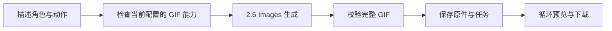

# GPT Image 2.6 驱动表情与头像板块分析与改造建议

日期：2026 年 11 月 5 日

范围：TaoStudio Image Lab 的表情与头像场景、切图后的动图入口，以及相关请求、存储和交付链路。

状态：早期方案分析，保留原始评估过程。用户后续明确要求移除原先两个快捷区并开发通用 GIF 工作台；最终参数与实现以 [GIF 工作台说明](gif-workbench.md) 为准，包括按指定官方指南开放 64 帧。

## 决策结论

**应把 GPT Image 2.6 原生 GIF 作为新创作动表情的优先路线，把当前战斗精灵图工坊降为专业工具；需要保持上传头像或既有贴纸身份的任务，仍需保留参考图编辑与本地组帧路线。**

现有方案的主要问题，是把“得到一个可用的动态表情”转化成了“正确生成一张网格图，再正确切图、去底、对齐和编码”。2.6 提供完整 GIF 输出后，这些中间步骤不再适合作为普通用户的默认流程。但“旧方案已经完全不能用”也不成立：原生 GIF 的公开契约只覆盖生成端点，编辑端点不支持 GIF；官方发布页的部分示例也仍采用精灵图提示词。[S1][S2]

因此不能仅把 `gpt-image-2.5-flare` 改成 2.6。产品入口、请求约束、动画文件识别、任务持久化和后处理规则都需要一起调整。改造成功的定义应当是：用户得到身份与动作符合要求、循环可接受、可保存和下载的动画，而不是接口返回了 HTTP 200。

建议分三步推进：

1. 验证当前服务商、账户和代理能否返回真实多帧 GIF，先解决接入是否成立。
2. 打通“描述角色与动作 → 原生 GIF → 任务历史 → 原件下载”，再依据样本质量决定默认模型。
3. 单独评估“原头像动起来”、透明贴纸、逐帧编辑与平台适配，避免用第一条路线的结果替代这些需求的验证。

本轮仅交付分析与后续实施依据，不修改产品逻辑。

## 从第一性原理定义用户要的结果

### 四种需求具有不同约束

| 用户任务 | 不可丢失的约束 | 合适的起点 |
| --- | --- | --- |
| 创作一个新的动态表情 | 表情清楚、动作可读、首尾循环、文件能发出去 | 2.6 原生 GIF 文生动图 |
| 让现有头像或贴纸动起来 | 角色身份、脸、服装、画风与原图足够一致 | 参考图编辑生成姿势表，再组帧 |
| 制作一个角色的整套表情 | 跨作品身份一致、情绪有区别、组织与批量导出 | 先确认角色母版，再逐条生成与审核 |
| 制作动态头像 | 小尺寸和圆形裁切仍清楚、动作克制、目标平台接受动画 | 固定机位与构图，检验平台实际显示 |

这几种任务不宜共用一个“生成战斗动图”按钮。新角色文生 GIF 不等于参考头像动画化；同一动画内的角色一致，也不等于多次独立生成之间保持角色一致。

动态头像与动态表情可以共享生成与文件能力，但应采用不同的动作、构图和验收条件。头像更适合眨眼、轻点头、微笑等小幅动作；反应表情可以强调情绪与手势。大幅挥剑、翻滚、跳劈属于游戏素材需求。

### 动画的基本对象是帧序列与时间

一个动画可以表示为按时间排列的帧 `F₁…Fₖ`、每帧停留时间 `d₁…dₖ`，以及循环方式。它至少需要满足：

- **身份一致**：同一角色不能在相邻帧突然变脸、换装或改变比例。
- **运动成立**：动作顺序、幅度和节奏能表达意图，不能只是不同姿势依次闪现。
- **循环成立**：末帧到首帧没有明显突跳；文件重复播放并不代表视觉无缝。
- **交付成立**：文件保留全部帧与时间信息，刷新后可找回，目标平台能正确使用。

原生 GIF 减少了应用自己从网格图恢复时序资产的责任，但不会自动保证身份、动作或循环质量。API 契约只保证可请求并接收动画；它没有证明模型内部采用何种生成机制，也没有保证连续视频级运动。

### 应优化每个可用成果的总成本

只比较一次请求的价格或速度会误导决策。更有意义的指标是：

`每个可用成果成本 = 全部尝试的生成费用与人工修整成本 ÷ 最终可用成果数量`

旧路线每增加一个去底、切格、过滤或对齐步骤，就增加一类失败来源；这些错误还可能相互关联。原生 GIF 移除部分中间环节，具有减少失败面的潜力，但必须用相同任务的可用率、耗时和成本比较来确认收益。

帧率也不能单独决定流畅度。9 帧、每帧 200ms 的周期为 1.8 秒，约 5fps；这对停顿明确的反应表情可能足够，对挥剑连斩则未必。把 4 个姿势播放得更快，不会产生缺失的运动过渡。

## 官方能力与不能跳过的边界

### 已确认的 API 契约

下表以 2026 年 11 月 5 日读取的官方资料为准。模型页确认两个精确模型 ID；GIF 细节来自指南和接口参考。[S2][S3][S4][S5]

| 项目 | 官方依据 | 对工作台的含义 |
| --- | --- | --- |
| 模型 | `gpt-image-2.6-flare`、`gpt-image-2.6-sunburst` | 使用精确 ID，不使用未经确认的 `gpt-image-2.6` 别名 |
| 原生 GIF 请求 | `POST /v1/images/generations`，`output_format: "gif"` | 新增生成任务语义，不能继续要求返回一张网格图 |
| 返回 | `data[].b64_json` 中为完成的动画 | 解码成 GIF 原件，保留字节与正确 MIME |
| 编辑 | 编辑端点不支持 GIF 输出 | 不能向 `images/edits` 上传头像后要求直接返回 GIF |
| 时序控制 | `frame_count` 与 `frame_duration_ms`，只用于 GIF | 与静态图参数隔离，不能泄漏到 PNG 或编辑请求 |
| 尺寸 | `size` 表示成品每一帧的尺寸 | 不再是整张精灵图尺寸，不能继承 4K 静态图目标 |
| 流式能力 | GIF 不支持 streaming、partial images | 局部覆盖为非流式请求，不能继承档案中的流式开关 |
| 压缩与改写 | GIF 不支持自定义 `output_compression`、`prompt_rewriter` | 构造请求时省略，不能沿用“非 PNG 就加压缩参数”的规则 |
| complexity | `low`、`medium`、`high`，缺省为 `high`，独立于 quality | 控制规划而非渲染精细度；应显式设置并对照评测 |

原生 GIF 通过 Images API 已有明确依据；本方案不依赖 Responses API 或 Agent 生成 GIF。一般性“支持图像输入”描述，也不能扩展成 GIF 生成端点已经接受参考图：当前读取的生成 schema 没有参考图字段。[S2][S3]

### 官方资料存在参数冲突

| 参数或条件 | 图像生成指南 [S2] | 生成接口参考 [S3] | 本项目采用的保守策略 |
| --- | --- | --- | --- |
| 帧数 | 2–64，默认 9 | 2–16，默认 9 | 第一阶段只在 2–16 内试验，默认 9；不展示 64 帧承诺 |
| 帧间隔 | 20–2000ms，按 10ms 取整 | 最小 20ms，默认 200ms；编码延时上限 655350ms | 初期限制在共同范围内，按 10ms 步进 |
| 访问条件 | 介绍 GIF 能力 | 写有需要所选模型 GIF preview 权限 | 账户与服务商实际请求通过后，才视为可用 |
| 像素限制 | 帧数、每帧尺寸、`n` 共同受模型限制与总像素预算约束 | 要求满足模型 GIF 尺寸限制 | 从 `size: "auto"`、`n: 1` 开始，显式尺寸逐档验证 |

这些冲突意味着不能根据发布页就确定当前网关支持范围。第一阶段的较小参数集合是产品试验范围，不是对官方最终限制的重新定义。也不能直接套用旧模型静态图的最小像素、最大边长或 4K 规则。

### 原生 GIF 透明背景不能作为已具备能力

生成接口参考要求透明背景使用 PNG 或 WebP；GIF 指南没有建立 `background: "transparent"` 与 GIF 的支持契约。因此首版原生 GIF 应明确提供纯色或场景背景，不承诺透明贴纸。[S2][S3]

当前本地编码器已经体现了 GIF 的二值透明特性：柔软阴影、半透明发丝或光晕在编码时会失真。即使后续得到透明 GIF，也不能把它等同于 PNG 或 APNG 的完整 Alpha。透明是文件与交付链路问题，不能只在提示词里要求“透明”就认为完成。

需要透明素材时，优先评估 2.6 生成透明 PNG 姿势表并组帧，或对完整动画进行逐帧去底。后一种方案需要正确解码 GIF、合成增量帧、处理 disposal 和时间信息；现有对单张图的 Canvas 去底函数不能直接承担。

### 速度和费用应保持可验证

官方发布页对 Flare 与 Sunburst 分别强调快速迭代与细节编辑，但其中的静态图速度不能作为 GIF 的完成时间承诺。[S1][S4][S5]

当前官方标准价中，两款 2.6 的图像输入为每百万 token 8 美元，图像输出为 30 美元，文本输入为 5 美元。相同 token 单价不代表相同 GIF 单价，也不能把旧版一张静态图价格乘帧数当作精确报价。[S6]

对实际服务商，应记录返回的 usage（如有）、账单和有效成果数。若没有可核对的 GIF 用量明细，就保留“费用未知”，不展示伪精确的单条报价。缓存折扣是否适用于本链路也需要独立确认。

## 当前实现为什么不适合作为默认动图流程

### 实际存在两条动图路径

| 入口 | 当前行为 | 源码依据 |
| --- | --- | --- |
| 表情与头像首页的静态区 | 描述与表情快捷词 → 清除参考图与遮罩 → `submitTask` → sticker 场景历史 | `src/components/StickerWorkshop.tsx:90` |
| 首页战斗动图区 | 默认 4×4 网格、挥剑连斩；生成 sheet → 去底 → 切格 → 面积检查 → 质心对齐 → 预览与本地导出 | `src/components/StickerWorkshop.tsx:41`、`src/store.ts:1583`、`src/lib/stickerSplit/spriteSheet.ts:375` |
| 切图弹窗里的动图区 | 对现有贴纸生成 2×2 关键姿势表，使用原图作为起始姿势，按关键姿势时间线循环 | `src/components/StickerSplitModal.tsx:503`、`src/components/StickerAnimatePanel.tsx:69`、`src/lib/stickerSplit/actionFrames.ts:1` |

首页战斗路线是会话级 `spriteGif` 状态。源码明确注明不持久化，刷新即清；它没有像普通静态任务一样进入统一任务历史。底层 `fetchSpriteSheet` 虽支持可选参考图，但首页调用没有传参考图，`referenceImageId` 目前只保留空字段。不能把底层函数有一个参数描述成产品已经支持上传头像动画化。

### 已经失效的默认假设

**把空间网格当作动画接口。** 模型必须同时解决动作顺序、角色一致、网格规则和每格完整性。应用再猜测格子边界。原生 GIF 已有交付接口时，普通动表情没有必要继续承受这些附加约束。

**把战斗动作当作表情需求。** 当前预设主要是挥剑、出拳、受击和跳劈；这与用户想表达开心、无语、委屈、打招呼，以及头像轻微动态的目标不一致。模型升级不能修复入口目标错误。

**把能切出主体当作动画合格。** 当前面积检查可以排除部分空格或异常主体，但不能验证动作是否成立、脸是否稳定、首尾是否衔接。自动剔除帧还会改变原有时序。质心对齐适合部分素材，却也可能消除有意的位移。

**把本地导出当作任务完成。** 用户可能生成成功后还没下载就刷新。新的默认流程必须先保存原件与任务，再提供预览和下载；配额不足时明确提示并允许立即导出。

### 分辨率分配也发生了变化

当前默认整张 sheet 为 1024×1024、4×4 网格时，每格名义上只有 256×256，紧裁和留白还会降低主体有效像素。导出 512×512 不代表生成了原生 512 像素细节。

原生 GIF 的 `size` 指向每帧。但这并不意味着可以免费获得更多像素：请求工作量至少与 `W × H × 帧数 × n` 相关，具体计费仍以实际 token 为准。比如 9 帧 512×512 的总帧像素为 2359296，全部展开成 RGBA 就约 9 MiB，尚未计入解码副本和浏览器开销。这是资源估算，不是官方 GIF 限额。

### 仍值得保留的能力

参考图姿势表、透明 PNG 切图、APNG 与 PNG 帧导出，对于角色身份和透明交付仍有用途。官方发布页中的精灵图示例，也说明这种创作方法没有因 2.6 发布而自动失效。[S1]

应淘汰的是把它们强加给所有用户的默认流程。首轮实施不应大规模删除 `stickerSplit`，也不应重做静态切图工具；先把原生 GIF 做通，旧工具放入“专业工具”，让它服务真正需要网格素材或参考图控制的任务。

## 建议的产品结构

普通入口按用户结果组织为“静态表情”“动态表情”“头像”，不要求用户先理解精灵图、切帧和编码。头像页区分新创作与基于已有头像，生成前明确能否使用参考图。

### 动态表情的默认流程



首屏只需提供角色描述、反应动作、画风、背景和生成按钮。动作快捷词优先选择眨眼微笑、挥手、点头、无语、惊讶、委屈、开心等；允许补充动作描述。帧数、帧间隔和 complexity 放在高级选项，不再显示行列数和切格参数。

原生 GIF 暂不开放参考图输入，避免误以为上传已生效。若当前场景有遗留参考图或遮罩，提交前应阻止歧义并说明当前生成路线只使用文字，不静默带入编辑请求，也不偷偷丢弃用户选中的参考资产。

生成期间使用等待、已用时和取消等待等真实状态；GIF 没有流式预览，不显示假进度。取消等待只代表停止客户端等待，不能承诺服务端停止生成或免计费。

结果区优先显示完整动画、实际尺寸、实际帧数与周期、原件下载和重新生成。下载原件不二次编码。没有动画解码能力时，不承诺暂停到指定帧、删除帧、修改速度或导出 APNG。

### 动态头像的流程

新创作头像可以走原生 GIF，采用固定机位、小幅动作、稳定中心构图。提供圆形裁切与小尺寸预览；初始提示词可要求脸部与重要特征离边缘留出约 15% 余量，这只是待评测的构图建议。

已有头像动画化先走“参考图 → 2.6 编辑成 PNG 姿势表 → 本地合成”。应把它标为保留参考图特征的试验路线，逐项验证脸、配饰和画风；不能承诺像素级不变。已有 `actionFrames` 的原图起始帧与保守动作模板可以复用，但其阈值和修复规则应重新评测。

目标平台若只接受静态头像，交付封面 PNG 并提示其显示限制。GIF 文件生成成功与平台支持动态头像是两件事；平台尺寸、体积、帧率和上传要求必须在明确平台后核对，不能预置未经验证的通用承诺。

### 模型选择

Flare 作为新创作动表情的首个候选，Sunburst 作为精细角色与参考图编辑的首个候选。这是基于官方定位选择试验起点，不是本项目已经证明的性能排序。[S4][S5]

两款都用同一任务样本比较。若 Flare 可用率不足，允许选 Sunburst；不因超时自动切换模型并再次计费。模型、API 模式只对本任务生效，不更改全局默认或其他场景配置。

## 接入与持久化设计

### 最小请求契约

以下是第一轮探测用的请求体，不代表已在当前网关通过。它使用官方文档共同支持的默认时序与自动尺寸；服务商基址仍取场景档案。

```json
{
  "model": "gpt-image-2.6-flare",
  "prompt": "生成一个可无缝循环的可爱圆脸橘猫反应动图。固定正面机位，单一角色，纯米白背景。橘猫从自然微笑开始，闭眼开心笑，再恢复起始微笑。保持毛色、五官比例和头部位置稳定，动作逐步变化，末帧自然接回首帧。无文字、无边框。输出完成的动画，不要输出精灵图或网格拼图。",
  "output_format": "gif",
  "frame_count": 9,
  "frame_duration_ms": 200,
  "size": "auto",
  "quality": "medium",
  "complexity": "medium",
  "n": 1
}
```

这个请求不添加 `response_format`、`output_compression`、`partial_images`、`prompt_rewriter`、mask 或参考图片；不启用 stream。提示词描述角色、不变条件、动作阶段和循环，不夹带旧版“生成 N×N 精灵图”指令。

`quality` 与 `complexity` 先固定，避免首次失败无法归因。接通后，再比较简单动作的 low complexity 与 medium complexity；不要把“越高越好”当作默认原则。

### 当前代码需要触达的位置

| 位置 | 已观察到的问题或可复用能力 | 最小改造方向 |
| --- | --- | --- |
| `src/types.ts:273` | 输出类型只有 PNG、JPEG、WebP；没有动画时序字段 | 建立可区分静态与 GIF 的任务参数；历史任务缺少新增字段时保持静态语义 |
| `src/lib/api.ts:10`、`apiProfiles.ts` | 统一按场景档案分发 | 复用配置解析；GIF 任务选择已验证的 Images 通道，避免修改共享档案 |
| `src/lib/openaiCompatibleImageApi.ts:643` | 档案可能导向 Responses、自定义映射或 Codex CLI | 提交前验证实际通道；不能仅凭模型名推定支持 GIF |
| 同文件 `:821` | 非 PNG 会带压缩参数；流式开关直接来自档案；未发送帧数和 complexity | 为 GIF 构造字段白名单，禁止不兼容组合 |
| `src/lib/imageApiShared.ts:6`、`:424` | MIME 表与实际参数识别未包含 GIF | 增加 GIF 识别与实际结果校验，避免回落为 `image/png` |
| `src/lib/paramCompatibility.ts:76` | xhigh/max 仅按 2.5 名称识别 | 涉及 2.6 静态质量选项时补齐能力判断；GIF 首版只使用已验证档位 |
| `src/lib/taskOutputPersistence.ts:24` | 静态精确尺寸与比例校正会重采样；同文件还有去底后处理 | GIF 原件绕过这些单图 Canvas 变换；所有衍生文件另存 |
| `src/lib/dbWeb.ts:496` | 原图边界可转 Blob 存储，具备复用基础 | 验证 GIF 原字节往返，不另造存储系统 |
| 同文件 `:878` | 缩略图通过 Canvas 转 WebP | 用作静态封面，不能替代动画原件；明确封面采样策略 |
| `src/lib/downloadImages.ts:9` | MIME 扩展名表已经支持 GIF | 保留现有下载实现，补原件一致性验证 |
| `src/store.ts:458`、`:1583` | 首页动画独立会话状态；未入普通任务历史 | 新路线进入统一任务生命周期与 sticker 历史；旧状态留给专业工具 |
| `StickerWorkshop.tsx`、`StickerAnimatePanel.tsx` | 两个不同用途的入口 | 分别接线，不只替换首页按钮文案 |
| `workers/api-proxy.js:254`、`api/proxy.js:294` | 请求 JSON 整体转发；返回体整体缓冲 | 先验证参数与多帧文件穿透，再按实测决定是否调整代理 |

建议给生成结果补充动画元数据：媒体类型、生成路线、请求与实际模型、实际宽高、帧数、帧延时、循环信息、原件 ID、封面 ID、生成耗时。名称与存储结构沿用现有任务模式，避免先建设通用媒体平台。

只扩展一个 `output_format` 联合类型是不够的：GIF 的帧参数只能用于 GIF，参考图、遮罩、透明后处理、静态尺寸校正和流式参数又必须被排除。应通过明确的任务类型或提交守卫，让不合法组合在请求前失败。

### 原件保真是 P0

原生结果校验至少检查 GIF 签名、合法结构和实际多帧，不能靠扩展名、MIME 或搜索一个字节值判断。还要核对实际尺寸、帧时间与循环设置，发现“请求 GIF 却返回 PNG／单帧”时明确报错，不标为动画成功。

保存与下载的原件必须字节一致。静态封面可独立生成，列表显示封面与动图标记；进入详情或主动预览时才加载动画，避免整屏 GIF 同时播放。需要暂停与指定帧操作时，应使用经过兼容性验证的动画解码方案，而不是假设普通 `` 能控制播放。

现有 `gifenc` 是编码器；`encodeGif`、APNG 编码器接收已解码的像素帧。它们不能直接把一个原生 GIF 变成逐帧编辑器。首版不必因此引入完整 GIF 编辑依赖；先保障原件、元数据和封面，逐帧功能单独评估。

动画配额与内存按实际文件字节和解码负载限制。沿用现有配额不足保护，保留可立即下载的结果；不要让“封面写入成功”掩盖原件保存失败，也不要求本次同时建设 R2 或数据库。

### 服务商能力与失败处理

现有 `providerCapability.ts` 只记录尺寸观测，不能作为 GIF 支持证明。可以沿用其观察思路，用当前配置、端点、模型、代理方式与访问上下文记录已验证的 GIF 能力；不记录密钥，也不写死任何网关主机名。

`/models` 列出 2.6，只能证明模型名称可见；还需一次小规模请求核对帧参数是否穿透、输出是否多帧。未知能力显示“待验证”，未开放 GIF 的配置不能继续发起无意义重试。

当前 `fetchSpriteSheet` 实际捕获所有错误并最多尝试三次；外层遇到本地处理失败还可重新生成一次。源码注释把它描述为传输重试，实际 catch 并未区分所有错误类别。新原生路线应统一由一层管理重试，不能复制这套嵌套策略。

参数错误、未授权、余额不足、审核拒绝不应原样自动重试。429 或临时错误使用有上限的退避；超时、断线或代理切换后，先判断是否可能已在上游执行，不能承诺重试不重复计费。普通图片失败后的提示词自动改写，也不能未经用户确认就改变已要求的角色或动作。

代理目前整体缓冲响应，原生 GIF 又通过 base64 JSON 返回，因此体积和等待时间必须实测。base64 比二进制约增加三分之一传输体积。保留现有 Worker 与 Vercel 回退边界；不以新增 SSE 解决 GIF，因为官方 GIF 不支持流式。[S2]

## 验证计划与采用条件

### 先验证接入

用上面的 `n: 1`、9 帧、200ms、自动尺寸请求，分别验证计划实际使用的直连或服务商通道、Worker 和 Vercel 回退。每条路径记录状态码、request ID（如有）、等待时间、文件字节、实际帧数、尺寸与延时，不记录凭据或完整个人参考图。

接入成立需同时满足：返回真实多帧、参数不被丢弃、文件能播放、保存刷新后可找回、下载字节与原件一致。`size: auto` 通过后再验证 256／512 等显式逐帧尺寸；尺寸未通过前不给用户展示为保证可用的选项。

### 再比较可用成果

以下是建议实验设计与采用门槛，不是已经取得的结果。

| 样本 | 对照路线 | 关注点 |
| --- | --- | --- |
| 六个文生任务，每项各做两次：橘猫微笑、卡通人物挥手、机器人无语、吉祥物点头、惊讶反应、简洁头像眨眼 | 当前 2.5 精灵图、2.6 Flare 原生 GIF、2.6 Sunburst 原生 GIF，共 36 个成果 | 身份、动作、循环、可用率、耗时、成本 |
| 四张已获授权参考资产，每项各做两次 | 当前参考姿势表、2.6 参考姿势表，共 16 个成果 | 脸、服饰、配色、画风与原图保真 |
| 相同实际动作提示词的 low／medium complexity 小样本 | 在接入和基础质量通过后追加 | 规划强度是否值得额外等待 |
| 伪 GIF、单帧 GIF、参数拒绝、超时、配额不足、刷新与取消 | 本地 fixture 或 mock 优先 | 错误不伪装成功，不丢原件，不重复扣费重试 |

生成任务总量与费用需在执行实验前按实际服务商预算确定；本轮未执行这些生成请求。样本应保持同一任务意图，各路线只添加必要的格式指令，固定非对照参数。人工评审尽量隐藏模型名称，避免把新版本预期当作质量证据。

对身份、动作可读性、循环与视觉缺陷分别评分，任何严重变脸、缺肢、明显静止或循环跳变都不能算可用。有限样本只能支持内部试用判断，不能作为大规模可靠性承诺。

建议原生 GIF 升为默认至少满足：

- 36 个对照成果中，候选路线自身的 12 个成果至少 10 个可用，并且可用率不低于旧路线；若存在收益与身份保真冲突，按任务类型分流。
- 已测路径中原件存储、刷新恢复与下载保真全部通过；不能用较高视觉评分抵消数据丢失。
- 记录 P50 与 P95 耗时、每个可用成果的实际费用。样本少时同时报告样本数与最大耗时，P95 仅作观察。
- 实际 GIF 尺寸、透明能力与目标平台支持均按已验证范围展示；超出范围不承诺。

### 实施后的回归

单元与集成测试覆盖参数互斥、MIME 与文件结构、任务恢复、GIF 绕过静态后处理、原件导出、无效结果和失败重试。保留 PNG／JPEG／WebP 与参考图编辑回归，确保 GIF 参数没有泄漏到其他场景。

前端用真实浏览器验证桌面与手机宽度：文字描述、生成等待、错误、结果预览、下载、刷新恢复、场景切换、圆形头像预览和减少动态效果偏好。参考图试验需核对真实上传与请求内容，不能只看 UI 出现了一张图片。

产品代码实施后按仓库要求运行 `npm test`、`npm run build`、`npm run lint`；UI 检查使用 `npm run verify:ui -- <待验证地址>`。线上地址检查只证明该线上版本；本地改动需在本地运行版本验证。provider／proxy 改动按仓库既有 smoke 规则补充，并增加真正覆盖 GIF 的检查，既有 4K PNG smoke 不能代替。

## 分阶段实施范围

| 阶段 | 交付 | 进入下一阶段的条件 |
| --- | --- | --- |
| 接入验证 | 确认账户与网关 GIF 权限、参数交集和真实文件 | 至少一个计划使用的完整通道通过 |
| 原生 GIF 基础版 | 新创作动表情、任务历史、原件保存与下载、错误状态；旧战斗工具移入专业入口 | 原件保真与失败处理通过，候选模型达到内部采用门槛 |
| 头像与参考资产 | 新头像构图预设、圆形预览；2.6 参考姿势表对照试验 | 明确两条路线的身份保持能力与交付限制 |
| 交付增强 | 按需求加入透明处理、逐帧编辑、APNG、批量表情与平台导出预设 | 解码、体积和目标平台要求已有依据 |

第一阶段的最小完整产品不是“模型下拉框里出现 2.6”，而是“一条新创作动表情可以生成、正确识别、保留所有帧、刷新找回并下载”。没有通过参考图保真和透明链路验证前，旧专业工具仍承担这些明确用途。

## 证据与适用范围

官方资料读取日期均为 2026 年 11 月 5 日。发布页用于能力背景；参数以指南、接口参考和实际服务商验证共同确定，冲突已在正文列出。

- [S1 OpenAI Images 2.6 发布介绍](https://openai.com/index/introducing-images-2-6/)，发布于 2026 年 11 月 4 日。
- [S2 官方图像生成指南](https://developers.openai.com/api/docs/guides/image-generation#generate-animated-gif-output)，原生 GIF、complexity、限制与成本说明。
- [S3 官方生成接口参考](https://developers.openai.com/api/reference/resources/images/methods/generate)，请求与响应字段、GIF preview 条件和参数范围。
- [S4 GPT Image 2.6 Flare 模型页](https://developers.openai.com/api/docs/models/gpt-image-2.6-flare)。
- [S5 GPT Image 2.6 Sunburst 模型页](https://developers.openai.com/api/docs/models/gpt-image-2.6-sunburst)。
- [S6 官方 API 定价](https://developers.openai.com/api/docs/pricing#image-generation)，标准 token 费率。

本地源码基线为 `d84bca1`；上述行号仅作定位，后续修改会变化。检查覆盖两个实际动图入口、场景 API 分发、请求构造、任务状态、输出后处理、Web 存储、下载与两种代理。源码支持的能力不等于生产站点已运行相同版本。

本轮新增此文档，未修改应用源码、未调用付费生成、未执行部署。当前服务商的 GIF preview 权限、2.6 实际质量、真实 GIF 耗时与费用、浏览器运行效果及平台上传表现，仍是实施前后的具体验证项。
